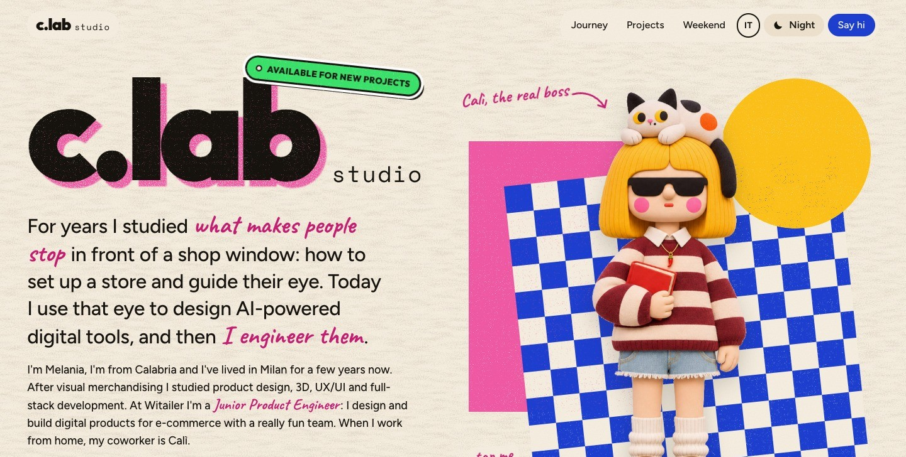

## Hi, I'm Melania

**Junior Product Engineer at [Witailer](https://www.witailer.com/).** I design AI-powered digital tools and then I build them, from the first sketch to the last line of code. Based in Milan.

I got here the long way. From 2016 to 2023 I worked in visual merchandising for H&M and Primark: shop windows in Bari, then in Calabria (employee of the year in 2022), then visual merchandiser manager in Milan. That's where I learned what makes people stop and look. Then came product design, 3D at IED, UX/UI at Talent Garden and full-stack development at Boolean. Today I use the same eye on software.

**→ [Step into my room](https://clabstudio.vercel.app/en/)**: my portfolio is a hand-drawn room you explore by scrolling. The case studies are in the folders on the desk, and Calì the cat is never far away.

### What I make

- Websites
- Digital platforms and internal tools
- AI tools, from idea to code
- Prototypes you can click

Got a project unlike any other? [Write to me](mailto:melrizzuto4@gmail.com).

### At Witailer

The code lives in private repos; the full stories are [in the portfolio](https://clabstudio.vercel.app/en/#progetti).

| Project | What it is | My part |
| --- | --- | --- |
| **Studio AI** | It flips how you read data: you start from the insights found in real Amazon sales data, then use AI to explore each one. | Experience, interface and development, through to the data connection and testing the answers |
| **STAT** | A tool everyone already knew, rebuilt from scratch: from a prototype on fake data, through feedback, to STAT 2.0. | UX, UI and all of the frontend |
| **Philo** | Reads the tools the team uses, keeps the gist in a knowledge graph and shows it as an office you can zoom in and out of. | Almost all of it: idea, UX/UI, identity and mascot, 3D in Blender, frontend and much of the backend |

### Code you can open

| Project | Stack | Links |
| --- | --- | --- |
| **c.lab studio**, this portfolio | Next.js, TypeScript, Supabase | [Live](https://clabstudio.vercel.app/en/) · [Code](https://github.com/Melrizzuto/c.labstudio) |
| **Mini e-commerce** | Nuxt 3, Vue 3, Pinia | [Live](https://mini-shop-black.vercel.app) · [Code](https://github.com/Melrizzuto/mini-ecommerce-nuxt3) |
| **Travel log** | Nuxt, Tailwind | [Live](https://travel-log-project.vercel.app) · [Code](https://github.com/Melrizzuto/travel-log-project) |
| **BoolBnB**, team project at Boolean | React, Express, MySQL | [Live](https://bool-bn-b-fe.vercel.app) · [Frontend](https://github.com/Melrizzuto/boolBnB-fe) · [Backend](https://github.com/Melrizzuto/boolBnB-be) |
| **Bookshop**, team project | React, Express, MySQL | [Live](https://book-fe-one.vercel.app) · [Frontend](https://github.com/Melrizzuto/book-fe) · [Backend](https://github.com/Melrizzuto/books-be) |
| **Boolflix** | React | [Live](https://react-boolflix-nine.vercel.app) · [Code](https://github.com/Melrizzuto/react-boolflix) |

From the academy: **Spotify Mood**, mood-based music discovery ([case study](https://github.com/Melrizzuto/spotify-mood-ux)), and **NewsQuest**, the news one swipe at a time. Both are in the portfolio.

### What I work with

**Design and build:** Claude Code, Claude Design, Claude Motion, HyperFrames, Higgsfield, Blender

**Code:** TypeScript, JavaScript, React, Next.js, Vue, Nuxt, Node.js, Express, MySQL, Supabase, Tailwind

### Education

- **Product Design**, BA, Università Mercatorum (graduated February 2026). Thesis on locus of control and immersive UX in spatial computing
- **UI Design Master**, Talent Garden (Sept – Dec 2025)
- **UX Design Master**, Talent Garden × Sketchin (May – July 2025)
- **Full Stack Web Development**, Boolean (Sept 2024 – May 2025)
- **3D modeling and rendering**, IED Milano (Nov 2023 – July 2024)

### Elsewhere

[Portfolio](https://clabstudio.vercel.app/en/) · [LinkedIn](https://www.linkedin.com/in/melania-rizzuto-57a42790/) · [Instagram](https://www.instagram.com/c.labstudi0/) · [YouTube](https://www.youtube.com/@Melerre), where in *Rifatto.* I redesign a famous product in one evening · [Email](mailto:melrizzuto4@gmail.com)

Calì approved.
